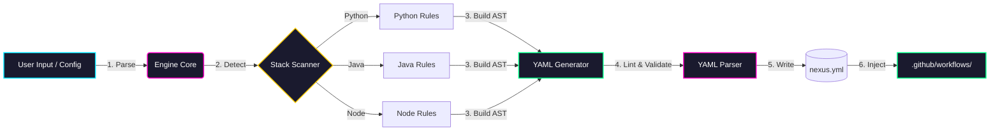

Voici la version **Pro** du README et du `.gitignore` pour ton dépôt `generateur-ci.yml`. J'ai nettoyé les artefacts de copier-coller, structuré les sections de manière logique, et ajouté les éléments qui font la différence entre un projet amateur et un projet d'ingénierie.

### 1. Le Fichier `README.md`

```markdown
<div align="center">

# ⚡ NEXUS YAML FORGE

> **You don't write YAML. You generate it.**

[](#)
[](#)
[](#)
[](#)

</div>

---

## 🏗️ Overview

**Nexus YAML Forge** is not a template copier. It is an **architecture engine** designed to generate, validate, and inject production-grade YAML pipelines (CI/CD, Kubernetes, Docker Compose) directly into any repository.

It parses the repository's environment, detects the stack (Python, Java, Node, Rust), and constructs the YAML AST programmatically. No indentation errors. No copy-paste drift. Just deterministic infrastructure.

---

## 🧬 Engineering Schema

Here is how the engine thinks and operates. Every arrow is a deterministic phase of the pipeline.



---

## 🚀 Quick Start

### 1. Clone & Install

```bash
git clone https://github.com/Aissamohammedi88/generateur-ci.yml.git
cd generateur-ci.yml
pip install -r requirements.txt
```

### 2. Generate a Pipeline

```bash
# Detect stack automatically and forge the YAML
python3 forge.py generate --target .github/workflows/ci.yml

# Force a specific stack
python3 forge.py generate --stack java --target .github/workflows/java-ci.yml
```

### 3. Commit

```bash
git add .github/workflows/ci.yml
git commit -m "ci: inject forged YAML pipeline"
git push origin main
```

---

## 🛠️ Architecture of the Forge

The engine is built on three strict layers:

1. **The Scanner (Perception)**
   Analyzes `package.json`, `pom.xml`, `requirements.txt`, `Cargo.toml`. Outputs a `StackProfile` JSON.

2. **The Builder (Cognition)**
   Uses a Python AST to build the YAML structure. Applies strict rules: Zero-Trust permissions, `concurrency` groups, intelligent caching.

3. **The Linter (Validation)**
   Parses the generated YAML with `ruamel.yaml`. If the YAML is malformed, it aborts and writes nothing. No broken files.

---

## 🛡️ Security Posture

- **Zero-Trust Generation**: Every generated workflow uses `permissions: contents: read` by default.
- **Fail-Safe**: The generator never overwrites a file unless it passes the YAML linter.
- **No Secrets in YAML**: The engine hardcodes references like `${{ secrets.GITHUB_TOKEN }}`, never raw keys.

---

## 📜 License

**NEXUS-OPEN-3.0** — Attribution required. Modifications must be documented.
Built by **Aissa Mohammedi (DGK)**.
```

---

### 2. Le Fichier `.gitignore`

```gitignore
# ═══════════════════════════════════════════════════════════════════════════════
# GENERATEUR-CI.YML — .gitignore
# ═══════════════════════════════════════════════════════════════════════════════
# Auteur : Aissa Mohammedi (DGK) — NEXUS-OPEN-3.0
# ═══════════════════════════════════════════════════════════════════════════════

# --- PYTHON ---
__pycache__/
*.py[cod]
*$py.class
*.so
.Python
build/
develop-eggs/
dist/
downloads/
eggs/
.eggs/
lib/
lib64/
parts/
sdist/
var/
wheels/
*.egg-info/
.installed.cfg
*.egg

# Environnements virtuels
.venv/
venv/
ENV/
env/
.python-version

# Tests & Caches Python
.pytest_cache/
.tox/
.nox/
.coverage
.coverage.*
htmlcov/
.hypothesis/
.mypy_cache/
.ruff_cache/
*.mo
*.pot

# --- NODE.JS ---
node_modules/
.npm/
.yarn/
.pnpm-store/
npm-debug.log*
yarn-debug.log*
yarn-error.log*
.pnp.*
.pnp.cjs
.pnp.js

# --- SECRETS & CONFIGS LOCALES ---
.env
.env.local
.env.*.local
secrets.yaml
secrets.json
*.pem
*.key
config.local.yml

# --- ARTEFACTS GÉNÉRÉS (Le plus important pour ce dépôt) ---
# Les fichiers générés par le forge ne doivent pas polluer le dépôt
*.generated.yml
*.generated.yaml
nexus_output/
forge_cache/
tmp/
temp/
*.tmp

# --- IDE / ÉDITEURS ---
.vscode/
.vscode/*
!.vscode/extensions.json
.idea/
*.swp
*.swo
*.swn
*~
.*.swp
.*.swo
.history/
.fleet/
.nvim/
.emacs.d/
.zed/

# --- SYSTÈMES D'EXPLOITATION ---
.DS_Store
.DS_Store?
._*
.Spotlight-V100
.Trashes
ehthumbs.db
Thumbs.db
Desktop.ini
$RECYCLE.BIN/
*.lnk

# --- LOGS ---
*.log
logs/
log/
npm-debug.log*
yarn-error.log*

# --- ARCHIVES & COMPILÉS ---
*.zip
*.tar
*.tar.gz
*.tgz
*.7z
*.rar
*.o
*.obj
*.a
*.lib
*.exe
*.out
```

---

